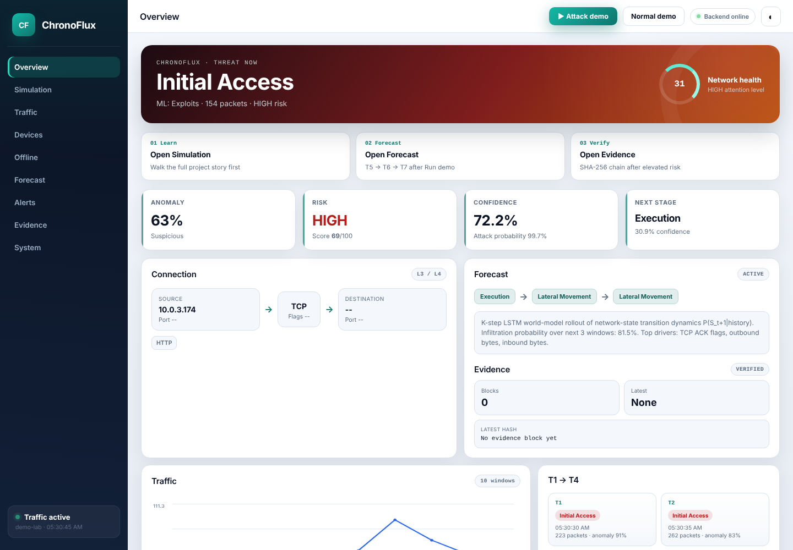
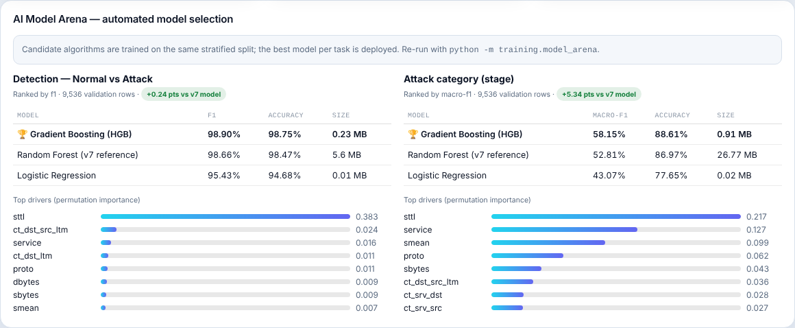

# ChronoFlux — AI-Based Network Attack Forecasting


**ChronoFlux** is a cyber-intelligence platform that answers four questions about network traffic:

| # | Question | How ChronoFlux answers it |
|---|---|---|
| 1 | **What is happening now?** | Hybrid detection: gradient-boosted classifiers + Isolation Forest anomaly model + behavioural signatures |
| 2 | **What is likely to happen next?** | An **LSTM world model** learns P(S<sub>t+1</sub> \| history) and rolls out T5/T6/T7 forecasts with infiltration probability |
| 3 | **Why should the defender care?** | Risk level, MITRE ATT&CK stage, attention-based driving features, recommended action |
| 4 | **Can the record be verified later?** | A SHA-256 hash-linked, tamper-evident evidence chain |

```text
DETECT → FORECAST (WORLD MODEL) → OBSERVE → VERIFY
```



---

## What's new in v8: the AI Model Arena

ChronoFlux now selects its current-state detectors automatically. `training/model_arena.py`
trains several algorithms on the **same** stratified split of 47,678 UNSW-NB15 flows, ranks
them, deploys the winner for each task, and explains the winner with permutation feature
importance. The leaderboard is shown on the **System** page and served at `GET /api/models/arena`.

| Task | Metric | v7 Random Forest | **v8 Gradient Boosting (deployed)** | Logistic Regression |
|---|---|---|---|---|
| Detection (Normal vs Attack) | F1 | 98.66% | **98.90%** | 95.43% |
| Attack category (10 classes) | Macro-F1 | 52.81% | **58.15% (+5.3 pts)** | 43.07% |
| Attack category (10 classes) | Accuracy | 86.97% | **88.61%** | 77.65% |
| Model size on disk | MB | 32.4 | **1.1** (about 30× smaller) | 0.03 |

Why gradient boosting wins: it uses **native categorical splits** for `proto/service/state`
and **sqrt-balanced class weights**. Together these lift rare attack classes
(Shellcode, Backdoor, Worms) without hurting precision on the common ones. Macro-F1 is used
for ranking because plain accuracy hides failures on rare classes.



```bash
python -m training.model_arena            # benchmark + deploy winners
python -m training.model_arena --dry-run  # leaderboard only
```

---

## NTRO problem alignment

| Requirement | ChronoFlux |
|---|---|
| Dual flow + packet features | Ports, bytes, IAT mean/var/max, TTL, TCP window, flags, fragments, retransmits, payload size, port-scan score |
| Learn P(S_t+1 \| S_t) | NumPy LSTM world model over T1–T4 state vectors |
| K-step forward simulation | T5/T6/T7 rollout + infiltration probability timeline |
| MITRE ATT&CK mapping | Stage → Reconnaissance / Initial Access / Lateral Movement / C2 / Exfiltration / … |
| Explainability | Attention + gated feature attribution (SHAP-style driving features); permutation importance for detectors |
| Model selection | AI Model Arena: RF vs gradient boosting vs logistic regression on the same split |
| Demo UI offline | FastAPI web console; CSV + **PCAP** upload |
| Baseline comparison | Logistic regression on the same features; Sequence RF ablation |

---

## Architecture

```text
 Sensor ──► demo seed / CSV / PCAP upload ──► dual flow + packet features
                                                    │
        ┌───────────────────────────────────────────┼─────────────────────────────┐
        ▼                                           ▼                             ▼
 Detection (Model Arena winner)            Isolation Forest anomaly        Behaviour signatures
        └──────────── Hybrid Risk = 0.50·ML + 0.30·Anomaly + 0.20·Signature ──────┘
                                                    │
                     T1..T4 state vectors ─► LSTM + attention ─► P(S_t+1 | history)
                                                    │
                    K-step rollout (T5/T6/T7) · infiltration probability · MITRE stage
                                                    │
                            SHA-256 hash-linked evidence chain + web console
```

### LSTM world model

Baselines on the same representation:

- Logistic regression (NTRO comparison)
- Sequence random forest (non-recurrent ablation)

```bash
python -m training.train_world_model
```

You can also click **Train / refresh world model** on the Forecasting page.

### Intelligence + evidence

The benchmark attack category is kept separate from ChronoFlux's behaviour stage and MITRE
interpretation. Elevated events are appended to a private SHA-256 hash chain.

---

## Project structure

```
ChronoFlux/
├── backend/api.py          # FastAPI app (all REST endpoints + static frontend)
├── core/                   # detection, anomaly, fusion, world model, forecasting, evidence chain
├── training/
│   ├── model_arena.py      # NEW: automated model selection + explainability
│   ├── train_world_model.py
│   ├── train_anomaly.py
│   └── train_all.py        # arena + anomaly + world model
├── models/                 # pre-trained weights (ready to run)
├── frontend/               # web console (HTML/CSS/JS)
├── data/                   # training CSV, demo samples, CIC-IDS-2018 / CTU-13 samples
├── data_tools/             # dataset download + converters
├── live/ubuntu_sensor.py   # Scapy gateway sensor (deferred in demo build)
├── tests/                  # pytest suite + runtime checks
└── docs/                   # architecture, features, demo scripts
```

---

## Quick start

### Windows

```text
START_CHRONOFLUX.bat
```

### Linux / macOS

```bash
python3 -m venv venv && source venv/bin/activate
pip install -r requirements.txt
python run.py
```

Open http://127.0.0.1:8000 (Chrome is recommended), then:

1. Go to **Simulation** and press **Play**.
2. Click **Run demo**.
3. Open **Forecast** and **Evidence**.
4. Open **System** to see the AI Model Arena leaderboard.

### Retrain everything

```bash
python -m training.train_all
```

### Tests

```bash
pip install pytest
pytest -v
```

---

## Data

- **Detection benchmark:** UNSW-NB15 (`GET_REAL_UNSW_AND_RETRAIN.bat` or `data_tools/prepare_real_unsw_dataset.py`)
- **Also supported:** **CIC-IDS-2018** and **CTU-13**, auto-mapped in Offline Analysis
  - Guide: `data_tools/EXTERNAL_DATASETS.md`
  - Samples: `data/samples/cicids2018_sample.csv`, `data/samples/ctu13_sample.csv`
  - Converters: `data_tools/convert_cic_ids2018.py`, `data_tools/convert_ctu13.py`
- **World model:** curated chronological lab progressions + live gateway / PCAP sessions
- UNSW / CIC / CTU rows are **not** treated as T1→T5 temporal ground truth unless they are
  true chronological windows.
- PCAPs are ingested with Scapy parsers in the offline PCAP path.

> The bundled models are built from the cleaned 47,678-row training file for prototype use.
> See `data/MODEL_DATA_NOTE.txt` for the full benchmark procedure.

---

## Key API endpoints

| Method | Endpoint | Purpose |
|---|---|---|
| GET | `/api/health` | Model readiness + capabilities |
| GET | `/api/system` | Full system status and metrics |
| GET | `/api/models/arena` | **AI Model Arena leaderboard + feature importance** |
| POST | `/api/predict` | Score one flow (detection + forecast) |
| POST | `/api/demo/seed` | Seed a curated attack progression |
| POST | `/api/offline/analyze-csv` / `-csv-stream` / `analyze-pcap` | Offline analysis |
| GET | `/api/forecast/evaluation` | Forecast vs observed-stage verification |
| GET | `/api/evidence/verify` | Verify the hash chain |

---

## Jury-ready answers

**What model forecasts attacks?**

> ChronoFlux uses an LSTM world model that learns network-state transition dynamics
> P(S_t+1|history) from dual flow/packet feature vectors. It rolls out K steps to estimate
> infiltration probability, maps predicted states to MITRE ATT&CK stages, and explains
> decisions with attention-based feature attribution. Logistic regression on the same
> features is the baseline; a sequence random forest is a non-recurrent ablation.

**How were the detectors chosen?**

> By an automated model arena. Random forest, gradient boosting and logistic regression were
> trained on the same split and ranked by macro-F1. Gradient boosting won with +5.3 macro-F1
> points over the earlier random forest, and it is about 30× smaller.

**How do you prove forecasting vs detection?**

> We store the time each prediction was issued, compare T5 against the stage observed later,
> and separately score genuine stage-transition forecasts with measured lead time.

**Known limitation (honest reporting)**

> On session-held-out evaluation the world model is trained on a small curated set
> (32 sessions). It generalises far less well to unseen sessions than to the stratified
> holdout. More chronological lab sessions is the main path to improvement.
